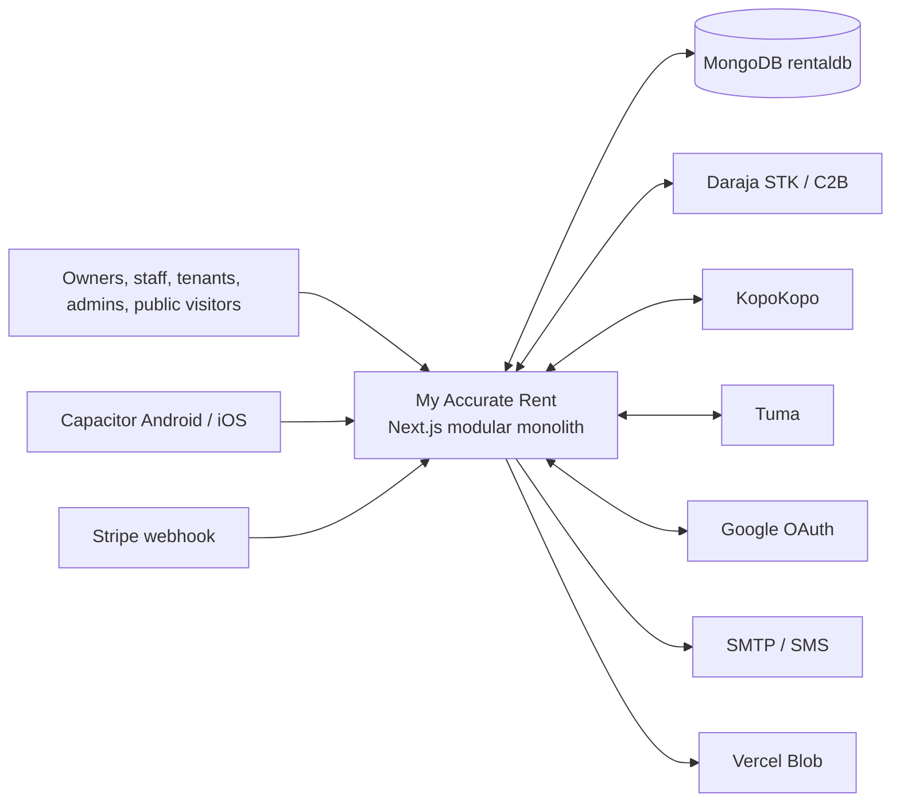
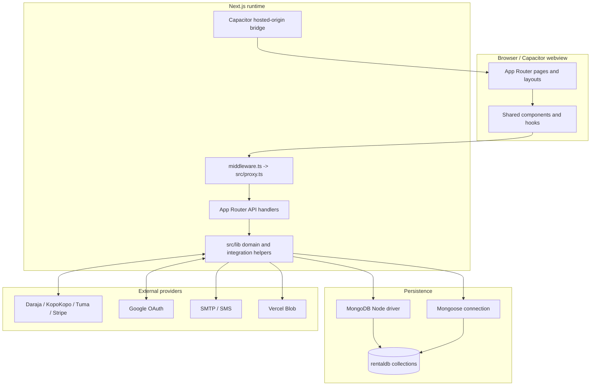
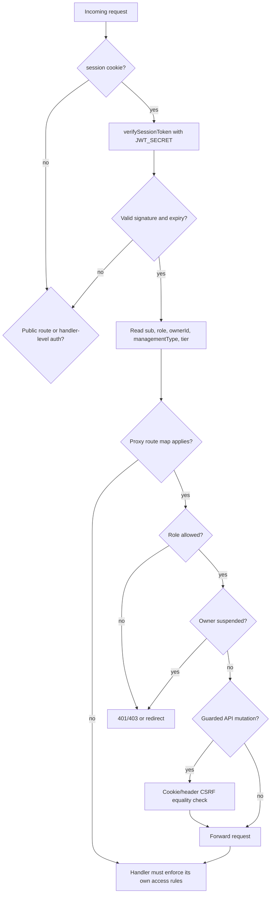
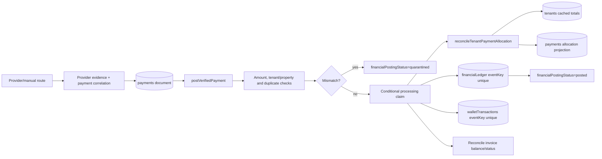
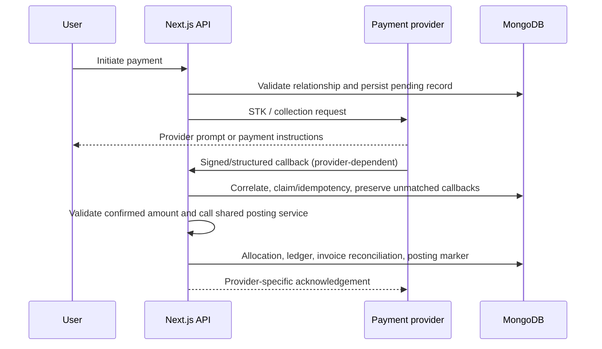
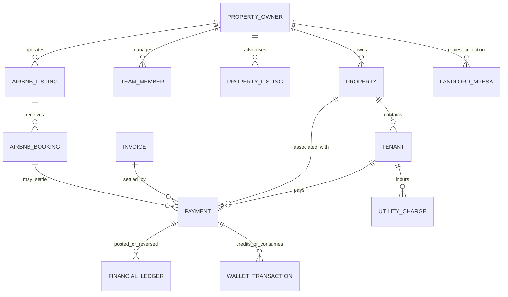
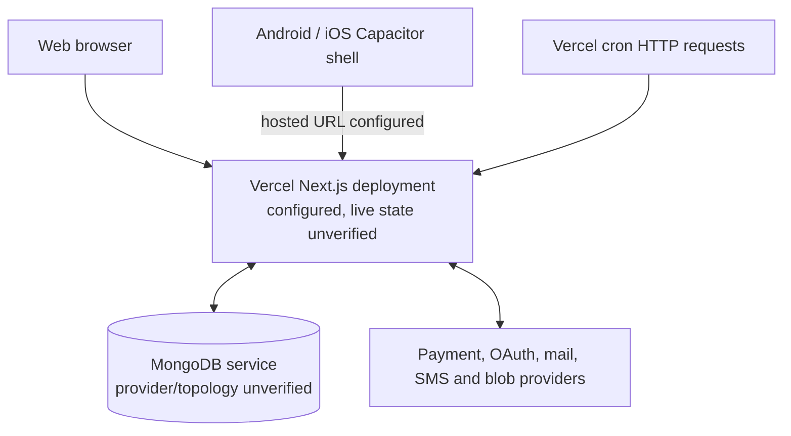

# Architecture diagrams

All diagrams below represent source-level relationships. Provider availability and deployed topology remain unverified.

## System context



## Application components



## Request lifecycle

```mermaid
sequenceDiagram
  participant C as Client
  participant P as Proxy/middleware
  participant H as Route handler
  participant L as Domain helper
  participant M as MongoDB
  C->>P: Request with session cookie
  P->>P: Verify JWT; resolve mapped role; CSRF / rate check where configured
  P->>H: Forward identity context and request ID
  H->>H: Validate input; route-specific authorization
  H->>L: Execute business operation
  L->>M: Query or mutate collections
  M-->>L: Result
  L-->>H: Domain result
  H-->>C: HTTP response
```

## Authentication and authorization



## Database interaction and payment posting



## External payment integration



Signature guarantees differ by provider. KopoKopo and Stripe verify signatures in the inspected handlers. Daraja callback correlation/claims are present, but a Daraja callback signature check was not found. C2B validation and confirmation endpoints are separate interfaces.

## Main data relationships



Edges express observed identifier relationships, not database-enforced foreign keys. Collection names are inferred from native driver calls; entity field shapes are not governed by formal schemas except `LandlordMpesa`.

## Deployment architecture



`vercel.json` configures install/build commands and cron schedules. It does not prove the project is currently deployed or that the cron requests authenticate successfully.
