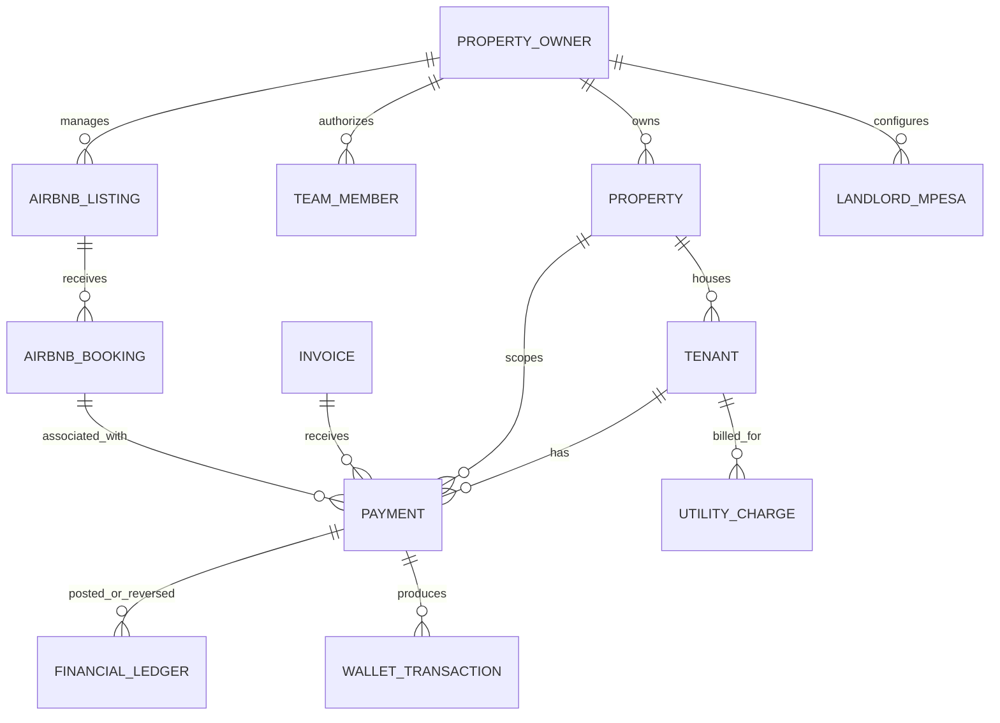

# Database architecture

## Technology and access patterns

**Verified:** MongoDB is the only database technology identified in source. `src/lib/mongodb.ts` uses `MongoClient` and selects database `rentaldb`; its global client promise supports warm runtimes and connection retries. The helper initializes declared production indexes asynchronously. Most handlers call the native driver directly. `src/lib/mongoose.ts` and `src/models/LandlordMpesa.ts` provide a second Mongoose connection path for payment routing. There is no migration directory or comprehensive schema registry in the inspected repository.

This means schema validation is distributed across Zod request schemas, TypeScript interfaces/types, route-level checks, the one Mongoose schema, unique indexes and conventions in helper functions. Most Mongo documents are flexible and can carry legacy variants (including string/ObjectId identity values and inconsistent status spellings).

## Formal Mongoose model

| Model / collection | Fields and constraints | Relationships |
| --- | --- | --- |
| `LandlordMpesa` / inferred `landlordmpesas` | `landlord` required ObjectId ref `Landlord`; `routingKey` default `default`; label; propertyIds string array; enabled; shortcode/passkey; paymentType enum `paybill|till|bank`; Paybill/Till/bank fields; isDefault; status enum `connected|pending|disconnected`; businessName; lastVerifiedAt; timestamps. Unique compound index `{landlord:1,routingKey:1}` plus landlord/enabled/default/update lookup index. | `landlord` refers to an owner/landlord identity; schema ref name `Landlord` does not match the repository’s evident `propertyOwners` collection contract, so actual population/collection equivalence is unverified. |

No Mongoose `populate()` usage was found. Other entities below are native-driver document collections with fields inferred from writes/queries, not enforced schemas.

## Discovered collections and relationships

The following collection names were found in static `collection("...")` calls. Collections created dynamically from variables or external tools may not appear here. Fields vary by code path; the list is a collection inventory, not a complete field schema.

| Domain | Collections | Key links / notes |
| --- | --- | --- |
| Identity and access | `users`, `propertyOwners`, `owners`, `teamMembers`, `adminTeamMembers`, `tenants`, `otpChallenges`, `passwordResets`, `entitlements` | Owners own properties; team members carry `ownerId`; tenants carry property/owner identity; sessions encode role and subject. `users`, `owners`, and `propertyOwners` overlap in legacy lookups. |
| Core rentals | `properties`, `tenants`, `utilityCharges`, `vacate_requests`, `tenant_deletion_requests`, `maintenance_requests`, `notifications` | Properties reference owners; tenants reference property and owner; posted utility charges reference tenant/property and period. These are app-managed references, not foreign keys. |
| Payments and billing | `payments`, `invoices`, `paymentSettings`, `financialLedger`, `walletTransactions`, `unmatchedMpesaCallbacks`, `tumaWebhooks`, `invoiceReminderLogs` | Payment rows reference tenant/property/invoice/provider; ledger records reference source payment; wallet entries reference tenant/payment. Invoice amount paid/status are projections reconciled from eligible payment rows. |
| Airbnb/short stay | `airbnbListings`, `airbnbBookings`, `airbnbCalendar`, `airbnbCalendarSettings`, `airbnbSettings`, `airbnbPricingRules`, `airbnbPricingSettings`, `airbnbTasks`, `airbnbCompliance`, `airbnbComplianceDocuments`, `airbnbGuestDocuments`, `airbnbGuestVerifications`, `airbnbSmartLocks`, `airbnbInventoryItems`, `airbnbStayExtensions`, `airbnbConversations`, `airbnbConversationMessages`, `airbnbMessageTemplates`, `airbnbMessageDeliveries`, `airbnbIntegrations`, `airbnbOwnerIntegrations`, `airbnbPayouts` | Most short-stay records use `ownerId`, listing IDs, booking `externalId`, and/or property identifiers. Exact cardinality and provider-side consistency are not enforceable from repository alone. |
| Public listings and support | `propertyListings`, `marketplaceSaleListings`, `contactLeads`, `supportTickets`, `supportMessages`, `ownerActivityLogs`, `auditLogs`, `integrationAuditLog` | Listing records include owner and original property identifiers; support/activity records use account/user references. Not all write paths establish immutable audit semantics. |
| Platform billing/referrals | `referrals`, `referralClicks`, `referralCommissions`, `subscriptionRewards`, `rewardLedger`, `payouts`, `referralSettings` | Referral/reward documents use referred/referrer, referral, user, source and payout identifiers; selected keys are unique by bootstrap. |
| Observability and devices | `systemErrorLogs`, `devicePushTokens` | Error logs are fingerprinted/grouped; device tokens associate push destinations to users/devices. |

## Main entity relationship diagram

Edges indicate fields and query relationships observed in code. The diagram does not imply all records are complete or referentially validated on every route.

## Important indexes

`src/lib/db-indexes.ts` declares production index bootstrap. It includes indexes for owner/property listing lookups, team membership, user roles, referral and payout idempotency, payment identifiers, utility periods, entitlements, unmatched callbacks, financial ledger events, wallet events and error logs. Notable uniqueness constraints include:

- `payments.paymentId` when string; Daraja provider+checkout, merchant, receipt keys; provider+providerTransactionId.
- Posted utility charges by tenant+utility+period+status.
- `financialLedger.eventKey` and `walletTransactions.eventKey`.
- Referral IDs, referred user IDs, payout idempotency keys/references, and entitlement owner/plan active pairs.
- Mongoose `LandlordMpesa` landlord+routingKey.

The presence of an index declaration does not verify that it was successfully created in the deployed database, that historical rows satisfy uniqueness, or that all important queries use an efficient index. `ensureProductionIndexes()` is invoked without awaiting it on the connection path; actual readiness/race behavior is unverified.

## Data conventions and integrity

- Identifiers are frequently strings in domain records and ObjectIds in Mongo `_id`; helper `identityValues()` queries both forms for legacy compatibility.
- Timestamps are a mixture of `Date` and ISO strings. Event time precedence is centralized in `payment-query.ts`, but other code has independent date logic.
- Money is generally represented as JavaScript numbers rounded to two decimals by `payment-query.money()` or invoice helpers; utility and M-Pesa boundaries can use whole-KES/integer amounts. There is no single database decimal type policy.
- `payments` is the transaction source; `financialLedger` stores uniquely keyed posting/reversal events, while tenant balances and invoice status are mutable projections/caches.
- Utility charges have posted-period uniqueness in the index plan. Tenant/property ownership links are conventions enforced selectively in services, not database constraints.
- Soft deletion is inconsistent: some administrative cascade deletion removes related documents; routine payment reversal is represented as a ledger event rather than source payment deletion.

## Integrity risks and controls

**Positive controls:** broad index bootstrap; unique financial event keys; payment provider identifiers; posted utility period key; shared `getFinancialPaymentRows()` handles successful legacy statuses and posted reversals; `postVerifiedPayment()` validates tenant/property equality when a tenant is linked and quarantines amount/identity conflicts.

**Risks:** schema drift from direct collection access; mixed string/ObjectId links; no general organization/tenant database boundary; some endpoints construct ownership filters differently; financial projections update across several writes without a transaction or durable outbox; operator and integration routes can use separate logic; date and currency precision are not fully uniform. A live duplicate/orphan scan was not run because no database was queried.

## Unverified

Database vendor/cluster, replica configuration, transaction capability, encryption-at-rest/in-transit settings, backup cadence, retention policy, actual created indexes, data cardinalities, orphan counts, and deployed schema history require operator or database access.
