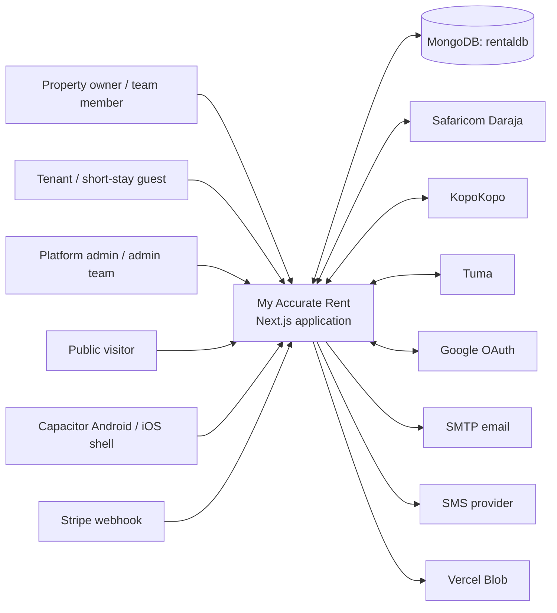

# System overview

## Product context

The source describes My Accurate Rent as a property/rental management platform branded for Sorana Property Managers Ltd. It serves property owners and their team members, tenants, internal administrators, and short-stay/Airbnb operators and guests. Public listing and marketplace pages are also present. The application manages operational records and payment events; this audit does not establish that funds are held or settled by the application.

## Architecture actually present

**Verified:** a Next.js App Router application, with React pages/components and server route handlers in one repository and one deployment configuration. Application logic is organized into `src/lib` helpers, but it is not consistently separated into strict domain, application, and repository layers. The app is therefore best described as a modular monolith with mixed direct database access and shared domain services. Native iOS and Android projects wrap the hosted web application through Capacitor.

There are no independently deployed application services or message broker definitions in the checked-in project. Scheduled work is exposed as authenticated HTTP cron handlers. MongoDB is the principal persistence boundary; the native driver is common, and a Mongoose model/connection serves payment-routing configuration.

## Main components

| Component | Responsibility | Evidence |
| --- | --- | --- |
| Next.js web application | Public pages, portals, dashboards and server rendering | `src/app/**`, `next.config.ts` |
| API route handlers | HTTP reads, mutations, callbacks and generated artifacts | `src/app/api/**/route.ts` (194 handlers) |
| Request proxy/middleware | Session decoding, route role gates, CSRF, in-memory rate limiting and request IDs | `middleware.ts`, `src/proxy.ts` |
| Domain/helper modules | Authentication, allocation, payment posting, reporting, integrations | `src/lib/**` |
| MongoDB | Application records, payment history, error logs and configuration | `src/lib/mongodb.ts`, `src/lib/db-indexes.ts` |
| Mongoose | `LandlordMpesa` routing configuration | `src/lib/mongoose.ts`, `src/models/LandlordMpesa.ts` |
| Third-party providers | Payment, OAuth, email, SMS and blob storage | Provider modules and `.env.example` names |
| Vercel configuration | Build/install commands and three scheduled API paths | `vercel.json` |
| Capacitor shells | Android/iOS app identity and hosted origin | `capacitor.config.ts`, `android/`, `ios/` |

## External boundaries

**Verified by code/configuration:** Daraja/M-Pesa STK and C2B, KopoKopo, Tuma, Stripe webhook handling, Google OAuth, SMTP through Nodemailer, BlessedTexts SMS, Vercel Blob upload support, and native push-notification components are referenced by implementation/configuration. Airbnb integration modules and owner integration records exist; the precise external channel capabilities depend on provider configuration and are not proven operational here. `WhatsApp` helpers also exist; delivery provider and deployment readiness are unverified.

**Unverified:** production URLs, provider account ownership, whether each integration is enabled, current callback registrations, settlement behavior, uptime, backups and data retention.

## System context

The integration arrows show code-level interaction, not verified production connectivity. `rentaldb` is selected in the MongoDB helper. Data ownership is mostly represented by owner, property, and tenant identifiers; a first-class organization/company entity was not established in the inspected model layer.

## System boundary and trust

The browser/mobile shell, provider callback senders, Google, email/SMS vendors, Vercel runtime, and MongoDB are separate trust boundaries. Payment callbacks are parsed and correlated with pending records; Daraja has a claim flow, KopoKopo verifies an HMAC signature, and successful ordinary tenant payments are sent through `postVerifiedPayment()`. C2B unmatched and ambiguous events are stored for reconciliation. Production credentials are expected from deployment environment variables and database-backed owner integrations; values are intentionally not reproduced here.

## Architectural limitations

- Route handlers frequently combine authorization, validation, database operations, business rules, and side effects.
- Business rules are not centralized uniformly: shared payment posting and allocation exist, but invoice status, legacy totals, some short-stay flows, and some direct update routes use different paths.
- No worker queue, durable outbox, separate service deployment, or general recurring job runner was found. Vercel cron routes are the checked-in scheduler interface.
- Current deployed topology, scaling limits, database topology and backup/recovery procedures require operator access.
